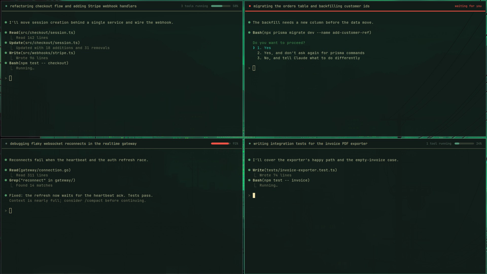

# Claude Strip



A thin status strip at the top of every terminal window running Claude Code, so
you can tell your agents apart when several run side by side:

```
● native-cards · fixing OTA asset paths · 3 tools running
```

The dot is accent-colored while the agent works, muted when idle, and urgent
red when it is waiting on a permission prompt. On the right, the strip shows
the tool count and a bar for how full the context window is (it turns red
above 85%). While the agent is waiting on you, the bar gives way to a red
"waiting for you" and the divider line turns red too.

It has two halves that talk through a small state file per session:

| Part | Where | Job |
| --- | --- | --- |
| `claude-mod/` | Claude Code mod (`session-strip`) | Publishes project, task and running-tool count for each session |
| `omarchy-plugin/` | Omarchy shell plugin (`taylorburke.claude-strip`) | Draws a strip over each matching terminal window |

The strip is terminal-agnostic: each session is matched to its Hyprland window
by walking the process tree, so foot, Alacritty, kitty and ghostty all work.
It is a header in the theme's background color with a 2px divider line below
it, drawn over the top of the window, so it covers the first one or two
terminal rows. Its text is the same size as the terminal's own text (read from the
terminal's config: foot, Alacritty, kitty and ghostty are supported). Hovering the
strip shows the full title in a tooltip, but only when a narrow window elides it.

A new session shows no strip until you send its first prompt, so Claude Code's
startup banner stays fully visible.

**Drag the strip to move its window.** A floating window follows the cursor. A
tiled window lifts out of the layout while you hold it and is re-tiled where you
drop it, on the side of the window under the cursor, like Hyprland's own drag.

## Install

Requires Omarchy (Hyprland + Quickshell shell), Python 3, and Claude Code.

```sh
omarchy plugin add https://github.com/TaylorBurke/claude-strip --enable
```

The strip is driven by the `session-strip` Claude Code mod. If the mod is not
installed, the plugin shows a notification offering to install it (at most once a
week); nothing is installed unless you click it. To install it yourself instead,
type this at a Claude Code prompt:

```
/plugin install session-strip --marketplace TaylorBurke/claude-strip
```

Open Claude Code sessions need `/reload-plugins` (or a restart) to pick the mod up.

## Uninstall

```sh
omarchy plugin remove taylorburke.claude-strip
claude plugin uninstall session-strip
rm -rf "$XDG_RUNTIME_DIR/claude-strip"    # optional: leftover state files
```

Neither half edits your shell, Hyprland or terminal configuration. The plugin
only adds itself to the plugin list in `shell.json` when you enable it.

## Configuration

Mod options (Claude Code config menu):

- **Summarize the task with Haiku** (default on). After turn 1 and then every N
  turns, one Haiku call through your session's own client rewrites the title
  (8-14 words, naming the concrete feature or bug). It sends the project name,
  the last four prompts (each cut to 300 characters) and the start of the
  assistant's latest reply (500 characters), and costs about $0.001. Off: the
  title is the first prompt, truncated.
- **Re-summarize every N turns** (default 3).

The strip's text size is taken from each window's terminal config, so it always
matches the session text. Its height follows Omarchy's system font setting
(`Style.fontScale`); `dividerHeight`, `padding` and `borderSize` sit at the top
of `omarchy-plugin/Service.qml`. Long titles are elided on the right in narrow
windows.

## How it works

The mod writes `$XDG_RUNTIME_DIR/claude-strip/<claude-pid>.json` on prompt,
tool, permission and turn events. `scan.py` joins those files with
`hyprctl clients`, places each session relative to its monitor, and deletes
files whose process has died. `Service.qml` re-runs it on every Hyprland event
and once a second, and draws one layer-shell strip per session.

## Dependencies and privileges

Plugins run unsandboxed with your user permissions, so for transparency:

- **Runs:** `python3 -I omarchy-plugin/scan.py` once a second and on Hyprland
  events, which in turn runs `hyprctl clients -j` and `hyprctl monitors -j`.
  A long-lived `geometry.py` reads Hyprland's event and command sockets
  (read-only) and reports window positions, so strips follow resizes frame by
  frame. While you drag a strip, `follow.py` talks to Hyprland's socket to float, move
  and re-tile that one window. At load, `mod_setup.py check` runs
  `claude plugin list` and, only if the mod is missing, sends a notification; on
  your click it runs `claude plugin marketplace add TaylorBurke/claude-strip`
  and `claude plugin install session-strip@claude-strip`.
- **Reads:** `/proc/<pid>/stat` (to walk parent processes) and the state files
  in `$XDG_RUNTIME_DIR/claude-strip/`.
- **Writes/deletes:** only state files in that directory, and only stale ones
  (dead process or ended session). The mod writes them; the plugin deletes them.
  A drag leaves a short-lived `drag-*.pending` marker there so a window is
  re-tiled if the drag is interrupted, and the install prompt touches
  `$XDG_STATE_HOME/claude-strip/mod-prompted` to ask at most weekly.
- **Network:** none from the plugin. The mod's optional Haiku call goes through
  Claude Code's own client, like any other turn.
- **No root, no installers, no second Quickshell process.**
- **Removal:** disable or remove the plugin and the strips disappear at once;
  `rm -r $XDG_RUNTIME_DIR/claude-strip` clears leftover state (it is also wiped
  on logout).

## Known limits

- **Waiting state clears late.** Claude Code has no event for the moment you
  approve a permission prompt, so the red "waiting for you" state clears when
  the approved tool finishes.
- **The strip takes the mouse.** It is not click-through (hover and drag need
  input); it only covers terminal rows you could not see anyway.
- **Always on top.** The strip is a layer-shell surface, so a floating window
  dragged over a Claude window is drawn beneath it.
- **Hyprland only.** Window lookup uses `hyprctl`.
- **Window-per-session.** Tabs and multiplexers (tmux panes) share one window,
  so only one session per window is shown.

## Development

```sh
claude plugin test claude-mod                       # mod tests
(cd omarchy-plugin && python3 -m unittest -q test_scan test_follow test_mod_setup)
claude plugin validate .                            # mod + marketplace
omarchy plugin validate .                           # Omarchy manifest
```

## License

MIT
